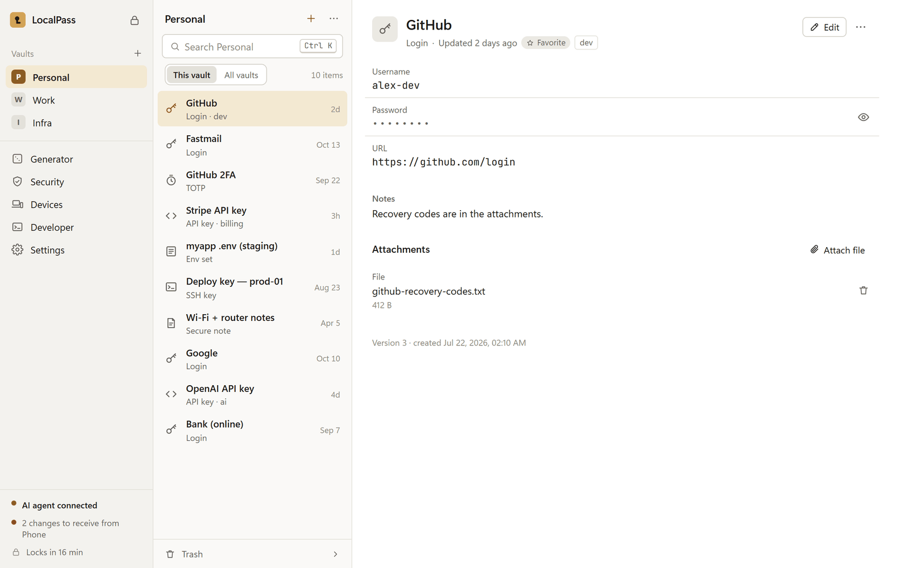
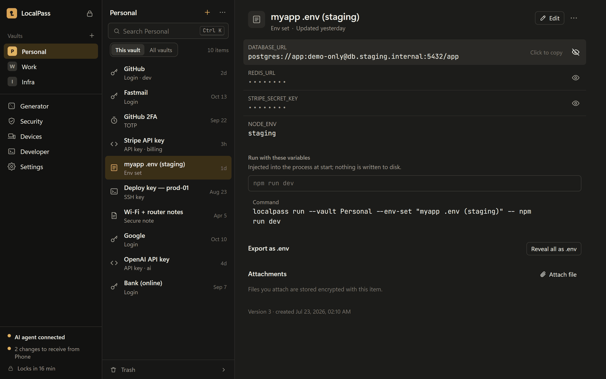
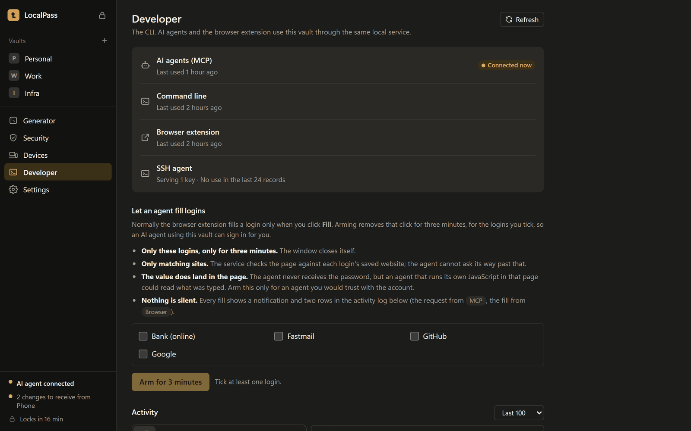
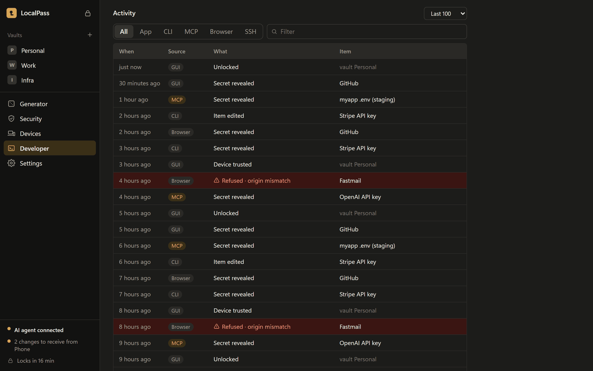
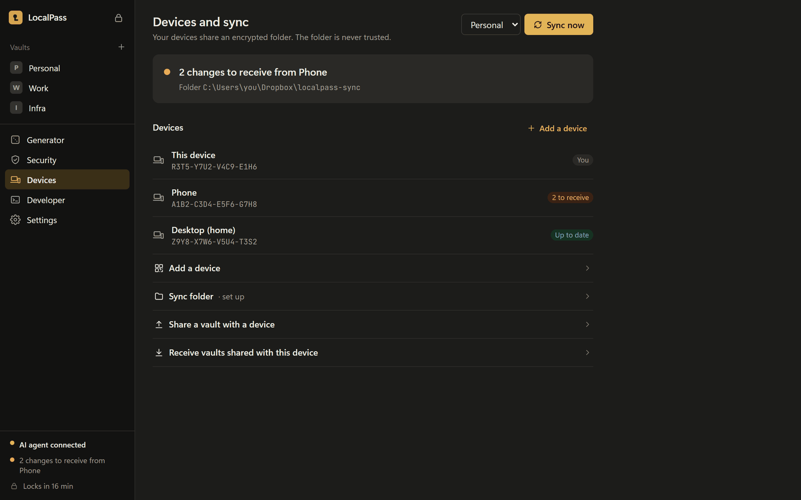
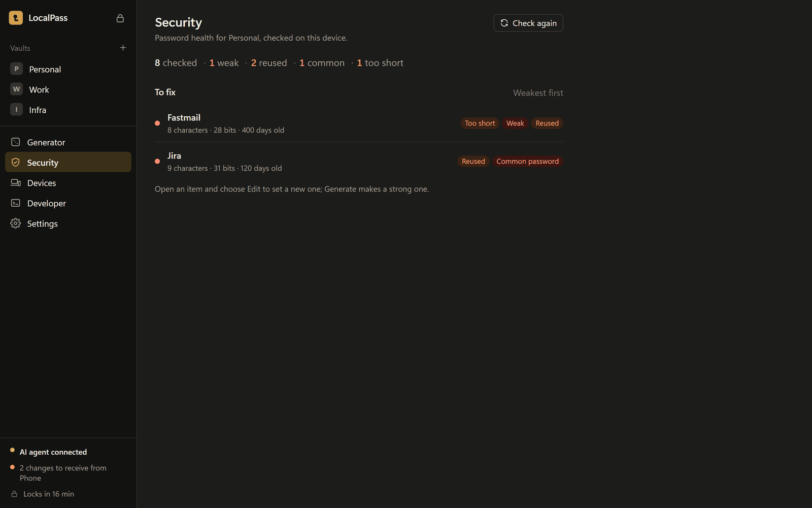
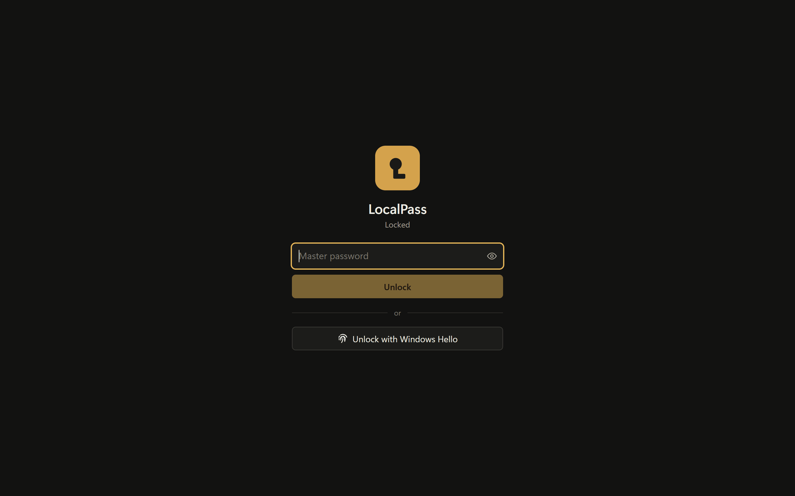
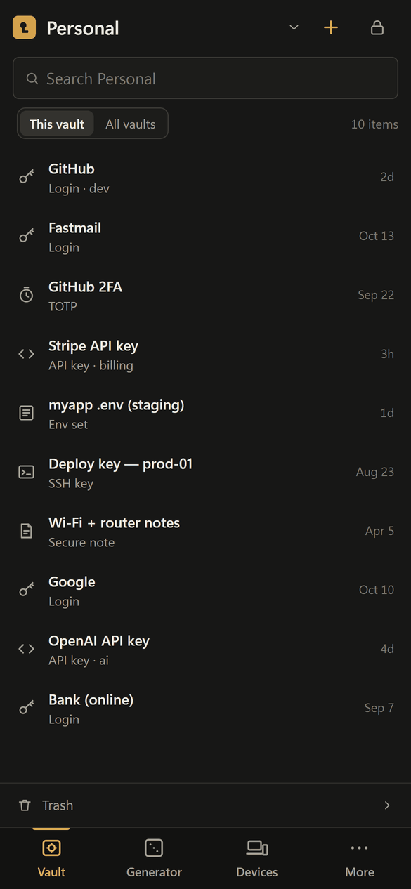
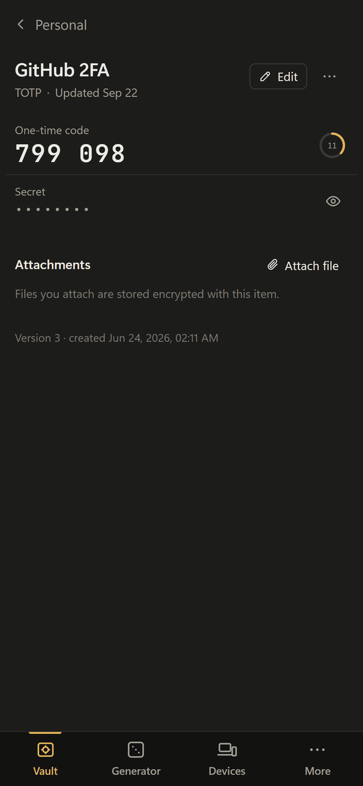

# LocalPass

A fully local, self-hosted password and secrets manager — an open-source alternative to 1Password with a strong developer focus: `.env` secrets, API keys, SSH keys, certificates, and secure sharing across your own machines without any cloud dependency.

> **Work in progress.** LocalPass is under active development and is not yet ready for real secrets. The storage format may still change before the first release.

<picture>
  <source media="(prefers-color-scheme: dark)" srcset="docs/screenshots/vault-dark.png">
  
</picture>

## Screenshots

All screenshots use made-up demo data.

<table>
  <tr>
    <td width="50%"><br><b>.env files</b>: click a value to copy it, or run a program with all of them</td>
    <td width="50%"><br><b>AI agents, CLI, browser, SSH</b>: what is using your vault right now</td>
  </tr>
  <tr>
    <td width="50%"><br><b>Activity log</b>: who touched which secret, and what was refused</td>
    <td width="50%"><br><b>Sync</b>: your own devices, through a folder you choose</td>
  </tr>
  <tr>
    <td width="50%"><br><b>Password health</b>: weak, reused and common passwords</td>
    <td width="50%"><br><b>Windows Hello</b>: unlock with your PIN, fingerprint or face</td>
  </tr>
</table>

<p>
  
  &nbsp;
  
</p>

## What exists today

The MVP feature set is implemented across eight crates/apps. See
[docs/architecture.md](docs/architecture.md) for the full map and
[docs/mvp-acceptance.md](docs/mvp-acceptance.md) for an honest, line-by-line
status against the PRD (including what is still partial or deferred). What
still stands between `main` and a 1.0 release is tracked in
[docs/release-checklist.md](docs/release-checklist.md).

| Component | Status |
|-----------|--------|
| [PRD](PRD.md) + [format specs](docs/specs/) | ✅ Ratified v1.0 (vault format, encrypted search index, sync protocol) |
| `lp-crypto` — crypto core | ✅ Argon2id + Secret Key KDF, XChaCha20-Poly1305 envelopes, key wrapping, X25519 sealing, Ed25519 signing, BLAKE3 chaining, RFC-6238 TOTP |
| `lp-vault` — storage core | ✅ Account store, vaults, item CRUD with per-version keys, immutable history, trash + prune, signed op log with hash chain, encrypted incremental search index, backups |
| `lp-daemon` — key-holding daemon | ✅ Same-user IPC session reuse, idle auto-lock, vault-backed SSH agent |
| `lp-cli` — `localpass` binary | ✅ init/vault/item/search/generate/password, `run`/`env` secret injection, `totp`, `ssh`, `backup`, `import`/`export`, `sync`, `device`, `kit`, `mcp` (MCP server for AI agents) |
| `lp-sync` — sync engine | ✅ Signed op-log ingest + deterministic merge, file-based shipping, cross-device key sharing (live LAN/mDNS transport is a documented follow-up) |
| `lp-porter` — import/export | ✅ 1Password/Bitwarden/LastPass/CSV/`.env`/KeePass KDBX 4 import, age-encrypted archive export |
| `lp-native-host` — browser bridge | ✅ Fill-scoped native-messaging host (the extension UI itself is not yet built) |
| `apps/desktop` — Tauri GUI (MPL-2.0) | ✅ Zero-terminal: account creation, item CRUD, search, reveal/copy, live TOTP, generator, `.env` secure documents, encrypted attachments, and device linking + sync — bundles the daemon and auto-starts it |

## Building

Requires stable Rust (MSVC toolchain on Windows).

```sh
cargo build --workspace
cargo test --workspace
```

## Trying the CLI

```sh
cargo run -p lp-cli -- init                       # creates your account + Emergency Kit
cargo run -p lp-cli -- item add --title GitHub --username you --generate
cargo run -p lp-cli -- item get GitHub            # masked by default
cargo run -p lp-cli -- item get GitHub --field password   # raw value for scripting
cargo run -p lp-cli -- search git
cargo run -p lp-cli -- generate --words 5
```

**Print your Emergency Kit and store it offline.** There is no cloud reset: losing your master password, Secret Key, and devices means the data is gone — by design.

## Secrets for AI coding agents (MCP)

`localpass mcp` runs a [Model Context Protocol](https://modelcontextprotocol.io) server on stdio, so an AI coding agent can **use** your secrets without ever **seeing** them.

```sh
localpass unlock                          # so the server proxies through the daemon
claude mcp add localpass -- localpass mcp # register it with Claude Code
```

The rule is absolute: **no MCP tool ever returns a raw secret value.** Anything a tool returns is copied into the agent's transcript — logged, replayed, often sent to a third party — so a password that reaches a transcript must be considered disclosed. Instead:

- `list_vaults` / `list_items` / `get_item` return ids, titles, kinds, and field **names**, with every secret value **masked**;
- `run_with_secrets` is the only path a value takes out of the vault, and it goes exactly one place — the **environment of a child process** the agent runs (`npm test`, `psql`, a migration) — then every occurrence of it is **redacted out of the captured stdout/stderr** before the reply is sent;
- `totp_code` returns the current 6-digit code (a short-lived derivative), never the TOTP seed.

There is no tool to create, edit, delete, or export anything. Full tool reference and the redaction contract: [docs/specs/mcp-server.md](docs/specs/mcp-server.md).

**One honest caveat:** `run_with_secrets` runs a command *as you*. It refuses to run LocalPass itself, and a LocalPass CLI inside that command refuses to read the vault, but a deliberately hostile command can still reach an **unlocked daemon** directly. If your agent reads untrusted content (repositories, web pages, issues), keep the daemon locked and let `localpass mcp` unlock on its own route, or don't use `run_with_secrets`. See [threat notes](docs/specs/mcp-server.md#7-threat-notes).

## Desktop app (GUI)

The [`apps/desktop`](apps/desktop) Tauri app is a zero-terminal way to use LocalPass — create your account, browse and edit items, reveal/copy secrets, read live TOTP codes, manage `.env` documents and attachments, and link + sync devices. It's a thin daemon **client** and holds no key material; secret handling stays in Rust behind an explicit-gesture boundary. See [apps/desktop/README.md](apps/desktop/README.md) for the architecture and security notes.

There is no pre-built download yet, so you build the installer from source.

**Prerequisites (Windows):** stable Rust (MSVC toolchain), [Node.js](https://nodejs.org) v24+, and WebView2 (already bundled with Windows 11).

```powershell
cd apps/desktop
npm install
npm run bundle          # builds the daemon, stages it as a sidecar, runs `tauri build`
```

The installer is written to `apps/desktop/src-tauri/target/release/bundle/` as an NSIS `.exe` (and/or MSI). Run it to install. The daemon ships **inside** the install and the app auto-starts it on launch, so the installed app is fully self-contained — nothing else to set up.

> The installer is **unsigned** (pre-1.0), so Windows SmartScreen shows an "unrecognized app" prompt — click **More info → Run anyway**.

Two shortcuts if you'd rather not build a full installer:

```powershell
# Run the app directly (dev mode); needs the daemon on PATH — see below.
cd apps/desktop && npm install && npm run tauri dev

# Put the CLI + daemon on PATH (also satisfies the GUI's dev-mode daemon lookup).
cargo install --path crates/lp-cli --path crates/lp-daemon
```

macOS and Linux builds use the same `npm run bundle` command (producing a `.dmg` / `.AppImage` / `.deb`), but are not yet CI-verified — see [docs/mvp-acceptance.md](docs/mvp-acceptance.md).

## Security model (short version)

Everything on disk is encrypted (XChaCha20-Poly1305) under a key hierarchy rooted in your master password **and** a locally generated 128-bit Secret Key, so a stolen vault file cannot be brute-forced offline. Every ciphertext is bound to its exact location (vault, item, version) so blobs cannot be cut-and-pasted. Every change is a signed, hash-chained operation. Read the full [threat model in the PRD](PRD.md) and the [format specs](docs/specs/).

## Security

LocalPass is **pre-1.0 and not yet independently audited — do not store real secrets in it yet.** See [SECURITY.md](SECURITY.md) for the disclosure process and security model.

## Contributing

See [CONTRIBUTING.md](CONTRIBUTING.md) — and read [LESSONS.md](LESSONS.md) for conventions and the decision log before proposing changes. [docs/architecture.md](docs/architecture.md) is the best starting point for the codebase. UI work follows [DESIGN.md](DESIGN.md) (tokens, type, the mark, motion, layout rules).

## License

AGPL-3.0 for core/daemon crates ([LICENSE](LICENSE)); MPL-2.0 for future GUI code ([LICENSES/MPL-2.0.txt](LICENSES/MPL-2.0.txt)). The desktop app bundles the JetBrains Mono font under the SIL Open Font License 1.1 ([LICENSES/OFL-1.1-JetBrainsMono.txt](LICENSES/OFL-1.1-JetBrainsMono.txt)).
